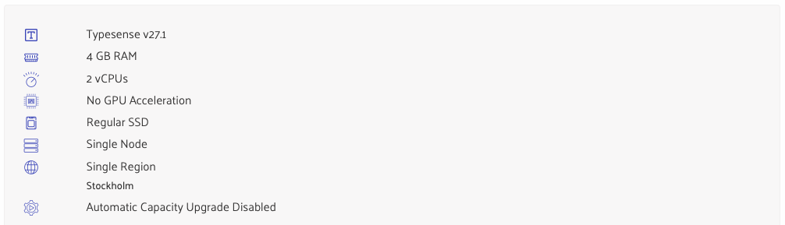

# Typesense Cloud

Typesense cloud setup is currently a manual process. The reason for this is that there are currently no mature Terraform
providers for provisioning Typesense cloud with.

## Learnings / Good-to-Know

* You can only update / upsert by id column, not by any other. Therefore, it is advisable to set the id column to
  something well-known (easy) or to save the returned auto-generated ID (harder). For the first data type (volunteering)
  we use `volunteering_${ID}`.
* Ingesting a larger number of documents with semantic search (embeddings) turned on can easily saturate the CPU, at
  least when tried on low power hardware. This results in multi-second response times for search queries, because reads
  and writes seem to be processed sequentially on the server.
    * When bulk ingesting, the default is to have 40 writes as a batch before the next search request is served.
    * Batching can be done on client-side on server-side. The `batch_size` parameter on the Python client library
      controls client-side batching.
* Memory usage determined mostly by which fields and which type of fields are indexed (i.e. the schema).

## Current Cluster Hardware Setup (as of 02.12.2024)

We currently run one Typesense cluster containing collections for both staging and production environments. This should
be fine during initial feature development for global search. The setup lacks load isolation between environments and
might require to be updated into 2 clusters once load increases in either of staging or production envs.

**Memory Requirements**
Memory is the most important sizing factor as Typesense holds the whole index in memory. The current index for
`staging_all` and `production_all` consumes about 2GB of memory each, resulting in a total of 4GBs for the cluster.

**CPUs**
2 vCPUs currently deliver low latency outside of ingestion times. During an active ingestion of documents, there's a
noticeable bigger latency but at this point of time it's considered good enough. Ingestion has been optimized using
client-side batching to result in lower latency (see pipeline code).

**All other settings**
The current setup is completely minimal to both save money and learn about the performance characteristics. During
feature development we'll most likely not need more hardware resources, this might change once we're in production.

## Security

Typesense allows scoping of API keys on two dimensions:

* collections an operation can be executed upon
* operations to be executed

Make sure to always constrain the API keys to the minimum required scopes in both dimensions and scope them to the
execution environment (staging / production).

Search-only API keys (those only allowing read operations) are no secrets and can be shared as part of client
applications.

